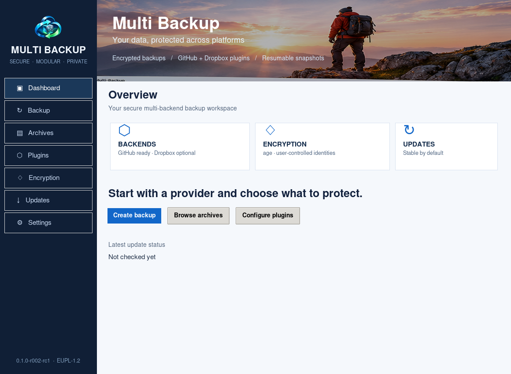

# Multi Backup

**Multi Backup `0.1.0-r018-rc1`** è un'applicazione multipiattaforma per backup cifrati, incrementali e riprendibili, basata su motori indipendenti (*plugin*) e distribuita con licenza **EUPL-1.2**.



## Caratteristiche

- **GitHub** (attivo per default): mirror dei repository Git e Git LFS, configurazioni, release, issue/PR, workflow, log e artifact CI; pulizia degli artifact **facoltativa**, con simulazione e protezione conservativa degli artifact usati per la distribuzione.
- **Dropbox** (disattivato per default): esportazione incrementale e cifrata delle versioni dei file tramite API di sola lettura, deduplicazione delle versioni già archiviate e manifest cifrati. **Non cancella e non modifica i file Dropbox, e non effettua purge dei backup locali.**
- **Ripresa** dopo interruzione tramite checkpoint e verifiche SHA-256; `--restart` avvia un ciclo nuovo, mentre `--resume` riprende quello incompleto mantenendone il nome e i checkpoint.
- **Interfaccia grafica** fotografica in stile glass blu/viola con Dashboard, Backup, Archivi, Ripristino, Plugin, Cifratura, Aggiornamenti e Impostazioni; finestra nativa About accessibile da menu Help, barra superiore e sidebar. Tasti Start/Resume separati e cancellazione locale protetta da conferma; CLI per consultare, estrarre e montare gli archivi.
- **Avanzamento:** gradiente antialiasing 4x rosso→giallo→verde e indicatore di attività animato solo durante un backup con eventi recenti; tasto hamburger per la sidebar. La libreria Rust è utilizzata nei pacchetti nativi macOS/Windows per il progresso e la politica di recupero CI; backup, ripristino, vault e GUI Rust completa richiedono ancora la migrazione con test E2E.
- **Early release:** commit su `main` contenente `[full-ci]`; **stable release:** push di un tag stabile come `v0.1.0`.
- Aggiornamenti: controllo all'avvio e ogni sei ore (predefinito), scelta del canale `stable` o `early-release`; download verificato con SHA-256. La RC non installa automaticamente eseguibili privi di firma e approvazione.

## Avvio rapido

Sono richiesti **Python 3.11+**, `age` e, per GitHub, `gh`, `git`, `git-lfs`. Prima di usare GitHub: `gh auth login`. I valori dei Secrets GitHub non sono esportabili tramite API.

```bash
python3 -m pip install -r requirements.txt
python3 multi_backup.py --version
python3 multi_backup.py plugins
python3 multi_backup.py keys generate --name primary
python3 multi_backup.py backup --backend github --recipient age1CHIAVEPUBBLICA --progress
python3 multi_backup.py backup --backend github --cleanup-ci-artifacts --cleanup-ci-dry-run --keep-ci-runs 5
python3 multi_backup.py gui
```

Abilitare il motore Dropbox esplicitamente e fornire il token **tramite variabile d'ambiente o portachiavi del sistema operativo**, mai come parametro o file di configurazione non protetto:

```bash
python3 multi_backup.py plugin enable dropbox
export MULTI_BACKUP_DROPBOX_TOKEN='TOKEN_PERSONALE'
python3 multi_backup.py backup --backend dropbox --recipient age1CHIAVEPUBBLICA
```

Per scegliere il canale degli aggiornamenti:

```bash
python3 multi_backup.py settings channel early-release
python3 multi_backup.py updates check
```

Gli archivi sono cifrati con `age`. Per visualizzarli e recuperarli usare `list`, `browse`, `view`, `show`, `extract`, `checkout`, `mount` o la GUI. Il montaggio necessita di spazio temporaneo su disco cifrato; `mount` richiede `bindfs` sotto Linux/macOS o `subst` sotto Windows.

## Distribuzioni native

La CI include job macOS 13+ (Apple Silicon e Intel), Windows 11 x64 e RPM per Rocky/AlmaLinux 8/9/10. La pubblicazione su GitHub Releases è associata ai due canali. Gli indici RPM vengono predisposti su `gh-pages`, ma le definizioni `.repo` restano volutamente disabilitate e richiedono firme GPG prima di un utilizzo production.

**Stato:** prima release candidate, test locali disponibili; le build native devono essere verificate sulle piattaforme di destinazione, e prima di abilitare aggiornamenti non assistiti devono essere configurate firma, notarizzazione e fiducia nei pacchetti.

## Documentazione

- [Manuale utente IT (PDF)](docs/manuals/Multi-Backup-Manuale-Utente-IT.pdf)
- [User manual EN (PDF)](docs/manuals/Multi-Backup-User-Manual-EN.pdf)
- [Brochure IT (PDF)](docs/brochures/Multi-Backup-Brochure-IT.pdf)
- [Brochure EN (PDF)](docs/brochures/Multi-Backup-Brochure-EN.pdf)
- [Canali di rilascio](docs/RELEASE_CHANNELS.md), [sicurezza](docs/SECURITY.md), [handoff](docs/HANDOFF.md).

**Licenza:** [EUPL-1.2](LICENSE).

### Production Gate unico e installazione macOS

Ogni push avvia un unico **Production Gate**, con test e audit di sicurezza; solo dopo il suo successo si avviano compilazione, verifica e pubblicazione. `[full-ci]` su `main` richiede una early-release; un normale tag di versione richiede una stable (ancora bloccata fino al completamento delle firme). La full CI si può avviare manualmente da **Actions → Multi Backup - Production CI → Run workflow**.

Il DMG corretto contiene un solo elemento visibile, **`Multi Backup.app`**, da trascinare nella cartella **Applicazioni**. Al suo interno si trovano la CLI e gli strumenti di cifratura; macOS deve disporre anche di `git`. Il DMG viene pubblicato **solo dopo** firma Developer ID Application, notarizzazione Apple sia dell'app sia del DMG, verifica Gatekeeper e test dell'app copiata fuori dal volume DMG. I precedenti DMG RC non firmati potrebbero essere rifiutati da Gatekeeper: **non disabilitare Gatekeeper**. Le credenziali necessarie vanno impostate come **GitHub Actions secrets** secondo [la documentazione dei canali](docs/RELEASE_CHANNELS.md).

## Funzionalità introdotte nella r013

Al primo backup si chiede esplicitamente se generare una chiave age e si richiede una password robusta (minimo 12 caratteri). La chiave privata è cifrata con AES-256-GCM e scrypt nel file `default.agevault`, conservato fuori dall'applicazione; gli aggiornamenti di Multi Backup non lo sostituiscono. All'avvio successivo, prima di aprire le pagine, serve sbloccare la chiave con la password. Lo sblocco resta valido fino alla chiusura dell'app. Le vecchie chiavi `default.txt` vengono migrate mantenendo la stessa chiave originale per ripristinare i backup precedenti.

Dalla pagina **Encryption** si può creare una **copia di recupero**, confermando la password della chiave corrente, scegliendo una nuova destinazione e impostando una seconda password per il file cifrato. La copia non sovrascrive file esistenti. Si può importare una copia soltanto quando non esiste già un vault locale. Su Mac con Touch ID disponibile, dopo uno sblocco con password si può attivare l'autenticazione biometrica nel Portachiavi locale; macOS gestisce il riconoscimento e la password resta sempre alternativa.

La nuova pagina **Restore** consente il recupero tramite lo stesso plugin con cui è stato creato l'archivio. La destinazione locale deve essere nuova. Il ripristino remoto GitHub richiede l'autenticazione e crea un nuovo repository; quello Dropbox chiede un token temporaneo con permessi di scrittura e carica un nuovo file, anche tramite sessioni per file grandi. I dati GitHub di configurazione, le CI e i metadata possono essere estratti localmente; la loro ricostruzione remota completa non è certificata.

Tutte le pagine sono scorrevoli; la sidebar include Restore e rimane collassabile. È possibile navigare con Ctrl+1…Ctrl+8. L'eventuale cleanup delle CI viene confermato esplicitamente a ogni backup. Gli aggiornamenti in early-release verificano i certificati TLS usando il bundle di CA incluso nell'app senza disabilitare la verifica SSL.

### Anteprime Rust native — test installazione

La CI della PR r020 genera pacchetti **senza Python** separati dalla r018: DMG a singola app macOS ARM64/Intel con firma ad hoc, installer Inno Setup e ZIP Windows x64, archivio eseguibile Ubuntu 24.04 x64. Sono anteprime non notarizzate Apple e non firmate Windows, senza ancora gli RPM Rust Rocky/Alma. La r018 rimane disponibile e invariata.

La GUI Rust r020 conserva la chiave age decifrata soltanto in RAM dopo lo sblocco del vault e permette ripristini locali/remoti senza un file di chiave privata in chiaro. Per macOS è predisposto il supporto Touch ID nativo (da validare su hardware reale); la CI include anche sei RPM Rust per Rocky/AlmaLinux 8/9/10. I pacchetti rimangono anteprime non stabili e non firmate per la produzione. Consultare [l'inventario della migrazione](docs/RUST_PORT_INVENTORY.md).
