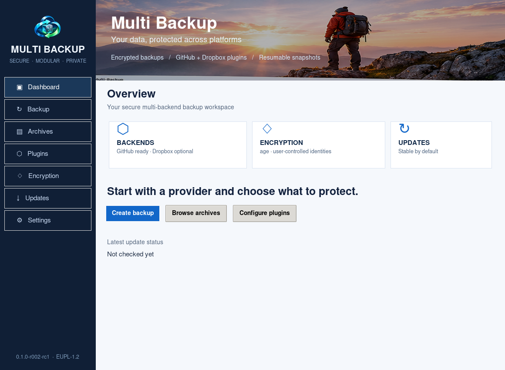

# Multi Backup

**Multi Backup `0.1.0-r016-rc1`** is a cross-platform, encrypted, resumable backup client with independent source plugins. It is licensed under **EUPL-1.2**.



**Release-candidate status:** GitHub backup and archive browsing are inherited from the previous `github-backup` tool. Dropbox incremental export and release discovery are new and require integration testing with real accounts. Native packages and RPM repository publishing are defined by CI but are not certified until their complete runners, installer validation, and signing checks have passed.

## Capabilities

- **GitHub plugin (enabled by default):** mirror repositories with Git LFS, retain distinct snapshots, back up metadata, issues/PRs, workflow runs, logs, release assets, GitHub settings and optional user-supplied credentials. All exported backup archives use `age` encryption. The CI artifact cleanup is **opt-in** and conservatively protects distributable artifacts; it can simulate actions before deletion.
- **Dropbox plugin (disabled by default):** read-only Dropbox API, list file revisions and back up changed versions as individual encrypted archives, reuse already verified objects, create timestamped encrypted manifests. **Never modifies or deletes files in Dropbox; never purges local backups.** Dropbox integration is an RC feature requiring live-account testing.
- **Resumable backups:** atomic archives, SHA-256 verification, checkpoint journals, `--restart` to create a fresh independent cycle.
- **Archive explorer:** list, display, extract, Git checkout and optional read-only FUSE mounting.
- **Native GUI:** Dashboard, Backup, Archives, Plugins, Encryption, Updates and Settings with real-time progress.
- **Two release channels:** `early-release` after a `[full-ci]` commit to `main`, and eventually `stable` after a stable version tag (for example `v0.1.0`). RC1 blocks stable publication until signed native packages and repositories are available. New versions are checked at launch and every six hours by default. Verified installers are staged but never executed without explicit approval.

## Requirements

Python **3.11+** for source execution; `pip install -r requirements.txt` for the graphical interface. GitHub backup additionally requires **Git, Git LFS, GitHub CLI (`gh`), and `age`**; `gh auth login` must have access to the requested repositories. Dropbox requires **age**, an `age1...` recipient, and an access token supplied via the `MULTI_BACKUP_DROPBOX_TOKEN` environment variable or an OS keyring entry (`service=multi-backup`, `username=dropbox`). Never put tokens in CLI arguments or settings files.

For native distributions, package dependencies are checked per platform. Linux RPM package builds are designed for **Rocky/Alma 8, 9 and 10 (x86_64)**, macOS builds target **Ventura 13+ on Apple Silicon and Intel**, and Windows builds target **Windows 11 x64**. Unverified CI builds and unsigned installers must not be treated as production-certified releases.

## Quick start

```bash
# From the source checkout
python3 -m pip install -r requirements.txt
python3 multi_backup.py --version
python3 multi_backup.py plugins
python3 multi_backup.py keys generate --name primary
python3 multi_backup.py backup --backend github --recipient age1YOURPUBLICKEY --progress
python3 multi_backup.py backup --backend github --cleanup-ci-artifacts --keep-ci-runs 5 --cleanup-ci-dry-run --progress
python3 multi_backup.py gui
```

Resume any interrupted GitHub cycle by repeating the same command and settings. Use `--restart` for a brand new cycle; existing complete archives are never silently overwritten.

For Dropbox (explicitly enable the plugin first):

```bash
python3 multi_backup.py plugin enable dropbox
export MULTI_BACKUP_DROPBOX_TOKEN='YOUR_TOKEN'  # Prefer your OS keyring if available
python3 multi_backup.py backup --backend dropbox --recipient age1YOURPUBLICKEY --dropbox-path ''
```

The plugin uses read-only Dropbox permissions and never calls a delete API. Each changed file revision is stored once; repeated cycles reuse SHA-256-verified encrypted archives. Private tokens are never added to a backup by this plugin.

## Browse and recover

```bash
python3 multi_backup.py list --output-dir "$HOME/Multi-Backups"
python3 multi_backup.py browse --identity "$HOME/.config/multi-backup/keys/primary.txt"
python3 multi_backup.py view /path/to/archive.tar.gz.age --identity /path/to/identity.txt
python3 multi_backup.py show /path/to/archive.tar.gz.age path/inside.tar --identity /path/to/identity.txt
python3 multi_backup.py extract /path/to/archive.tar.gz.age /safe/directory --identity /path/to/identity.txt
python3 multi_backup.py checkout /path/to/git-archive.tar.gz.age /fresh/checkout --identity /path/to/identity.txt
```

Use `mount`/`unmount` with `bindfs` on Linux/macOS, or `subst` on Windows; mounting requires a decrypted temporary working copy and therefore a private encrypted storage volume. Never expose decrypted temporary files to shared workstations.

## Release channels and updates

```bash
python3 multi_backup.py settings channel stable
python3 multi_backup.py settings channel early-release
python3 multi_backup.py updates check
python3 multi_backup.py updates download --download-dir "$HOME/Downloads"
```

Update discovery uses the public GitHub Releases API. Binary downloads require a GitHub-provided SHA-256 digest and enforce an HTTPS allowlist. **The RC does not silently install unsigned updates**. Trusted OS code signing, macOS notarization and signing keys for RPM repositories must be configured before enabling unattended upgrades.

The early release points to [GitHub Releases: early-release](https://github.com/desalvo/multi-backup/releases/tag/early-release); stable releases appear in [GitHub Releases](https://github.com/desalvo/multi-backup/releases). RPM `repodata` is generated for each Rocky/Alma version and channel on the `gh-pages` branch. Its `.repo` definitions are deliberately **disabled** (`enabled=0`, `gpgcheck=1`) until RPM and repo metadata signing is available.

## Documentation

- [User manual, English (PDF)](docs/manuals/Multi-Backup-User-Manual-EN.pdf)
- [Manuale utente, italiano (PDF)](docs/manuals/Multi-Backup-Manuale-Utente-IT.pdf)
- [Brochure, English (PDF)](docs/brochures/Multi-Backup-Brochure-EN.pdf)
- [Brochure, italiano (PDF)](docs/brochures/Multi-Backup-Brochure-IT.pdf)
- [Release channels](docs/RELEASE_CHANNELS.md)
- [Plugin architecture](docs/PLUGIN_API.md)
- [Security engineering](docs/SECURITY.md)
- [Development status and handoff](docs/DEVELOPMENT_STATUS.md)

## Security and limitations

- GitHub Secrets API **does not return the original secret values**. External storage, registries, and services need separate backup policies.
- Network and file errors are reported and archived only when safe; verify the completion report and restore a sample backup periodically.
- CI artifact deletions are **irreversible**, always opt-in, and not provably safe for external systems with undeclared dependencies. Keep a dry run first.
- Dropbox support only backs up file data and basic revision metadata in this RC, not complete Dropbox team/admin settings or sharing ACLs.
- Do not store encryption identities beside backup ciphertext; keep a separate encrypted/offline copy.
- Native GUI and installers are RC builds, not security-audited production software. See [security](docs/SECURITY.md).

### Development

```bash
python3 -m compileall -q .
python3 -m unittest discover -s tests -v
```

**License:** [EUPL-1.2](LICENSE). Contributions: see repository issues and the development handoff.

### Production Gate and macOS drag-and-drop installation (RC)

Every push first runs a single **Production Gate**, including security scanning; native jobs and publication run **only after it passes**. A commit with `[full-ci]` on `main` triggers early-release binaries, while an ordinary version tag targets stable (still blocked pending platform signing policies). You can manually trigger a full release from **Actions → Multi Backup - Production CI → Run workflow**.

The corrected macOS DMG contains only **`Multi Backup.app`**. Drag it into **Applications** and launch from Finder. The application bundle includes the CLI and cryptography helpers; `git` must be available on macOS. The **stable** macOS package requires Developer ID signing, notarization and Gatekeeper testing. Early-release builds use ad-hoc signatures solely for prerelease evaluation and may require explicit macOS Privacy & Security approval. See [Release channels and required GitHub secrets](docs/RELEASE_CHANNELS.md). Previously published, unsigned RC DMGs are not guaranteed to open and should not be installed. Do not bypass Gatekeeper.

### Dropbox integrity verification (r009)

Each newly downloaded Dropbox revision must match its listing file ID, revision, byte count and official Dropbox content hash before encrypted archive creation. A damaged pre-existing ciphertext is preserved and reported, never silently replaced. Dropbox objects without a valid content hash are not accepted.

### Try the macOS app without an Apple Developer account (r010)

To test the native app before general distribution, download `macos-arm64-preview` (Apple Silicon) or `macos-x86_64-preview` (Intel) from the successful **Multi Backup - Production CI** Actions run's Artifacts, or `multi-backup-macos-<arch>.dmg` from the `early-release` prerelease after a completed full CI on main. Verify the SHA-256 checksum included alongside the DMG; open the image and drag its **only visible item, `Multi Backup.app`**, into `/Applications`. No Python installation is required.

**Testing only:** the Mac app is ad-hoc signed, **not** Apple Developer ID signed or notarized. Gatekeeper can block its first launch. First attempt to open the app, then choose **System Settings → Privacy & Security → Open Anyway** if you trust the GitHub Actions build (labels vary by macOS release). Never disable Gatekeeper globally or use a command to strip quarantine. Do not use the preview as a generally trusted software distribution; `stable` still requires developer signing/notarization and all the other platform acceptance tests.


### Native navigation refresh (r011)

The desktop sidebar uses a high-contrast dark-navy design with clean rounded navigation surfaces, vector-drawn icons and explicit white text. This avoids the macOS Aqua Tk button foreground-colour override that could make sidebar labels unreadable. The active page has a vivid blue accent, hover and keyboard-focus feedback. Buttons are operable with mouse or Tab + Return/Space, and the same sidebar renders across macOS, Windows and Linux.

### Simplified GitHub backup (r012)

The desktop app now defaults to just **Backup destination** (the folder where encrypted archives are stored) and **GitHub username**. A one-time GitHub authorization is still necessary for private repositories: use **Connect GitHub account** to run `gh auth login` securely, then **Detect** to fill the name of the authenticated account. The app never stores GitHub access tokens in its settings. The selected account must match the signed-in login; other owners' repositories are not silently included.

**No staging or encryption configuration is required.** Staging is managed automatically inside the selected destination. **Changed in r013:** the first backup asks the user to create a password-protected age X25519 identity. The application now stores `default.agevault`, not `default.txt` (macOS: `~/Library/Application Support/multi-backup/keys/default.agevault`); existing unprotected keys are migrated without rotating the identity. The public recipient is derived from the key automatically. Use **Encryption → Save encrypted recovery copy** to create a separately password-encrypted recovery file, which is required to restore encrypted data if the local vault is lost. If the destination is not on an encrypted volume, temporary decrypted staging data may be exposed to local disk recovery; prefer an encrypted filesystem.

**GitHub Actions CI runs:** Preferences → **CI runs to back up per repo** (default 5) controls recent runs saved, including logs and available artifacts, even with cleanup disabled. **CI runs to keep if cleaning** is a different value and has no effect until the user explicitly selects cleanup in Advanced options. Cleanup runs only after a successful backup; an incomplete backup prevents deletion. The advanced controls can be expanded when necessary.

All GUI action buttons now have rounded glossy rendering and explicit readable labels independently of the macOS Aqua native theme. The sidebar can be collapsed with **Hide navigation** (or Ctrl+B) and reopened with **Show navigation**. Progress is presented as a rounded 3D-style bar with a red→yellow→green position gradient from 0% to 100%.

**Early-release macOS images:** `multi-backup-macos-arm64.dmg` and `multi-backup-macos-x86_64.dmg`, without test-only filename labels. The release is still a clearly marked prerelease, ad-hoc signed and not Apple-notarized. General distribution remains gated on the separate stable signing policy.

## R013 — Password-protected age key and session unlock

The first backup asks to generate a new age encryption key and to set/confirm a strong password of at least 12 characters. The age private key is **not left as a plaintext file**: an AES-256-GCM/scrypt password-protected `default.agevault` is stored outside the application under the private per-user app support directory. Whenever the app opens and a vault exists, it must be unlocked before navigating pages, checking updates or performing operations. The password is required only once in each application session. Software upgrades **do not overwrite the key**. On the first launch after upgrading from a previous version, the old `default.txt` identity is migrated into the vault while retaining the original private key, so older encrypted backup archives remain recoverable.

The **Encryption** page provides *Save encrypted recovery copy*, *Import recovery copy*, *Change vault password* and the vault location. Saving a copy requires re-entering the current password and choosing another password for the new encrypted recovery copy. Copies cannot overwrite existing vault files. No plaintext private key is sent to a destination or stored in preferences. Store the recovery file separately, with its password saved safely. Without the local vault or a recovery copy, backup contents cannot be decrypted.

On macOS devices with Touch ID enrolled, an **optional** biometric shortcut can be enabled **after** the app password has been verified. A signed helper uses a device-only macOS Keychain item protected by the current biometric enrolment; no fingerprints or OS login passwords are captured by Multi Backup. On the next launch, the user can select Touch ID or password. Changing the application vault password disables the previous biometric enrolment. Windows/Linux continue to use password access.

## R013 — Plugin-bound restore and navigation

The new **Restore** sidebar page lets the user select a locally stored encrypted GitHub or Dropbox archive. Both support recovery to a new local destination. Only the original plugin may be used: GitHub backups cannot be restored to Dropbox, and vice versa. For remote GitHub restoration, the app requires the GitHub CLI sign-in and confirmation of a **new** repository belonging to the authenticated owner; it restores the Git mirror and LFS content, never overwriting an existing repository. For remote Dropbox, an access token with `files.content.write` is requested only for the operation, not saved; the upload uses new-file-only semantics and resumable sessions for larger files. The backup archive remains unchanged. Remote reconstruction of all GitHub user settings, Actions metadata and secret values is **not** automated: GitHub Secrets API cannot export secret values. For those archives, local recovery remains available.

The interface uses scrollable content on all pages, preserves the collapsible sidebar and adds keyboard navigation (Ctrl+1 through Ctrl+8). Optional CI cleanup still requires explicit confirmation and runs after successful backup, never before.

## R013 — macOS early-release SSL validation

Update checks and downloads use a trusted `certifi` CA trust bundle packaged inside the actual app, with TLS certificate and host-name validation intact. The previous frozen-Python `CERTIFICATE_VERIFY_FAILED` issue must be resolved without disabling certificate verification. Release asset downloads also require SHA-256 digest verification.


## Explicit Start, Resume, and local archive deletion (r016)

The Backup screen offers **Start - New backup** and **Resume - Continue backup** as independent operations. Start passes --restart and always creates a new cycle ID/name; the previous incomplete checkpoint is safely archived for manual recovery. Resume passes --resume and requires a matching incomplete checkpoint. It never silently starts a new cycle or changes the original cycle ID. Dropbox also preserves its original timestamped manifest name and reuses already verified immutable encrypted objects.

From Archives, choose **Elimina archivio** to remove one explicitly selected local encrypted archive and same-name integrity/metadata companions. Deletion requires an unlocked vault, two-step confirmation including typing the filename, and is blocked while a backup is running or if the archive is referenced by the active GitHub checkpoint. An audit is stored in .state/archive-deletions.jsonl. The command never deletes remote objects or complete backup cycles. Deleting a Dropbox object required by an older manifest can make restoration from that manifest impossible.

The approved dashboard provides separate Start/Resume controls. The sidebar footer lists EUPL-1.2, author Alessandro De Salvo, version and build. Photographic backup storage/server compositions maintain natural aspect ratio with letterboxing as required; they are never stretched to fit.
