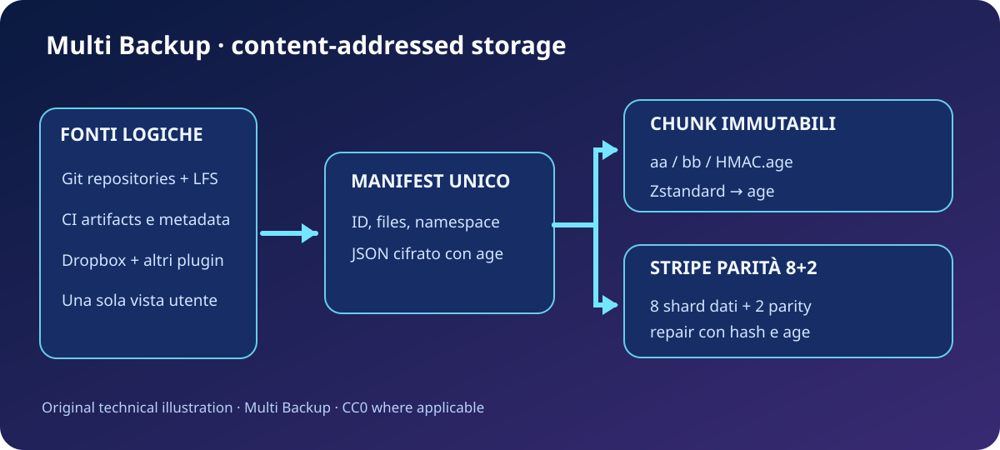
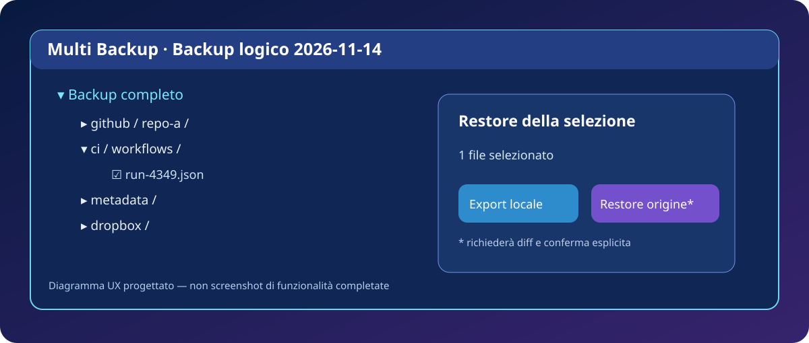

# Multi Backup — storage a chunk e backup logico unificato

**Stato: prototipo sperimentale r021, PR #9 (NON una release stabile).**
Il formato v1 è opt-in e **non sostituisce né modifica automaticamente** i
vecchi archivi \`tar.gz.age\`. Prima del rilascio servono test di compatibilità,
restore multi-TB, fault injection e review di sicurezza indipendente.

## Un backup logico, molti contenuti, un solo manifest

Un ciclo contiene una sola identità logica (ID univoco + etichetta) con più
namespace: \`github/\`, \`ci/\`, \`metadata/\`, \`dropbox/\`, e altri provider.
L'utente **non** vede tre backup distinti quando visita un ciclo.

| Entità | Visibile all'utente? | Recuperabilità |
| --- | --- | --- |
| Backup logico | Sì, **una sola scheda** | manifest cifrato |
| File/cartelle virtuali | Sì, come un file manager | chunk ordinati |
| Chunk compressi/cifrati | No, livello storage | address HMAC-SHA256 |
| Stripe di parità | Solo nella verifica integrità | Reed–Solomon 8+2 |
| Oggetti di quarantena | Solo nel monitoraggio tecnico | mai eliminati silenziosamente |

\`\`\`text
storage/
└── .multi-backup-v1/
    ├── config.json.age              # segreto di deduplica, recipient e dimensione
    ├── manifests/<64-hex>.json.age   # uno per backup logico, tutti i namespace
    ├── chunks/aa/bb/<64-hex>.age     # chunk zstd -> age, percorsi sicuri
    ├── stripes/<64-hex>.json.age     # mapping, lunghezze e checksum shard
    ├── parity/aa/<stripe-id>/{0,1}.age
    ├── quarantine/<id>-<nonce>.age
    └── .lock
\`\`\`

## Pipeline dei dati

\`\`\`mermaid
flowchart TD
 A[Git / LFS / CI / metadata / Dropbox] --> B[Un namespace virtuale per fonte]
 B --> C[Chunking fisso: 4 MiB]
 C --> D[HMAC-SHA256 col segreto dello storage]
 D --> E{Chunk verificato gia presente?}
 E -- si --> F[Riutilizza contenuto]
 E -- no --> G[Compressore Zstandard]
 G --> H[Cifratura age X25519]
 H --> I[Oggetto immutabile aa/bb/hash.age]
 I --> J[Stripe Reed-Solomon 8+2]
 F --> K[Manifest logico unico cifrato]
 J --> K
 K --> L[Browse / verify / selective restore]
\`\`\`

| Parametro | Default / politica | Stato |
| --- | --- | --- |
| Dimensione chunk | 4 MiB | implementata, configurabile 1–16 MiB alla creazione |
| Confini del chunk | fissi | implementati; FastCDC/content-defined **da fare** |
| Hash per deduplica | HMAC-SHA256 con segreto casuale da 256 bit | implementato |
| Hash plaintext | SHA-256 nel manifest age | implementato |
| Compressione | Zstandard, livello 3 | implementato |
| Cifratura | age X25519, singolo recipient per store | implementato in CLI sperimentale |
| Stripe | 8 data shard + 2 parity shard | implementato, da validare E2E |
| Spazio per parità | circa +25% rispetto agli 8 data shard | teorico; varia con dimensione e padding |
| Resistenza | fino a 2 shard assenti/corrotti per stripe | da certificare con fault injection |
| Sovrascrittura | no, nuovi manifest, file immutabili | implementato |
| Dati corrotti | quarantena prima di ricostruzione | implementato nel prototipo |

### Integrità e autoriparazione

Il recupero avviene sul **ciphertext age**, non su plaintext non autenticato.
La verifica ricontrolla checksum di ciascuno shard, identità logica del chunk
(HMAC), SHA-256 del plaintext e autenticazione age prima di accettare la
ricostruzione. Il codice rifiuta un numero di shard indisponibili superiore
alla capacità del gruppo. Le parità sono cifrate separatamente. File danneggiati
vanno in \`quarantine/\`, senza cancellazione automatica.

**Limite operativo:** una parità non è un secondo backup geograficamente
indipendente; non protegge da perdita dell'intero volume, ransomware con
accesso di scrittura, furto o cancellazione di tutti i dati. Servono repliche
indipendenti, retention, test periodici e chiavi di recupero offline.

### Sicurezza dei nomi e delle chiavi

Gli oggetti fisici si chiamano solo mediante hash validati di 64 caratteri,
in directory annidate: niente filename provenienti direttamente da provider.
I percorsi virtuali rifiutano traversal, nomi speciali/symlink, percorsi
Windows riservati e overwrite durante il restore. Gli HMAC del contenuto non
rivelano facilmente l'esistenza di file noti senza il segreto di deduplica,
a differenza dell'uso diretto di SHA-256 come filename. Il segreto dello store
è cifrato in \`config.json.age\`; la chiave privata age deve restare **altrove**.

Le identità protette \`.agevault\` del client esistente non sono ancora collegate
a tutte le operazioni v1: la CLI sperimentale legge una identity age dal
percorso indicato dall'operatore. Non mettere mai il file private-key dentro
la stessa directory dello storage.

## Esempio CLI Rust

\`\`\`bash
multi-backup-native storage init \
  --root "$HOME/Multi-Backups" --recipient age1... --chunk-mib 4

cat > sources.json <<'JSON'
[
  {"namespace":"github","directory":"/staging/github"},
  {"namespace":"ci","directory":"/staging/ci"},
  {"namespace":"metadata","directory":"/staging/metadata"},
  {"namespace":"dropbox","directory":"/staging/dropbox"}
]
JSON

multi-backup-native storage backup \
  --root "$HOME/Multi-Backups" --identity /secure/identity.txt \
  --label "Backup completo 2026-11-14" --sources-json sources.json

multi-backup-native storage list \
  --root "$HOME/Multi-Backups" --identity /secure/identity.txt --json

multi-backup-native storage protect \
  --root "$HOME/Multi-Backups" --identity /secure/identity.txt --id HASH

multi-backup-native storage repair \
  --root "$HOME/Multi-Backups" --identity /secure/identity.txt --id HASH

multi-backup-native storage restore \
  --root "$HOME/Multi-Backups" --identity /secure/identity.txt \
  --id HASH --selection github/owner/repo \
  --destination /new-empty/restore
\`\`\`

Il restore richiede una directory **inesistente** sotto un padre esistente;
mai sovrascrivere automaticamente dati originali. Una selezione può essere un
file singolo o prefisso di cartella. Le cartelle vuote e alcuni tipi di file
speciali non sono ancora supportati nel formato sperimentale.

## Specifica prevista: browser, mount e archivi portabili

| Funzione | Contratto progettato | Stato |
| --- | --- | --- |
| Browse unificato | albero virtuale icon/list, filtri, ricerca, selezione multipla | web preview mostra i file; UI ricca da implementare |
| Restore origine | singoli file/cartelle, diff e conferma | non abilitato; oggi solo nuova destinazione |
| Export locale | directory nuova con sola selezione | prototipo CLI/server |
| Mount read-only | macOS FUSE, Linux FUSE, Windows WinFsp, cache limitata | da implementare e qualificare |
| Export ZIP portabile | ZIP64, pacchetti default 2 GiB, indice firmato/checksum | da implementare |
| Import ZIP portabile | verifica tutti i volumi prima del commit | da implementare |
| Conversione storage | copia -> verifica -> switch atomico -> conservazione sorgente | da implementare |
| Migrazione da tar.gz.age | decrypt streaming -> chunk -> manifest -> verifica restore | da implementare |
| S3/NFS/Ceph backend | driver e lock coerenti per oggetti immutabili | da implementare |
| Garbage collection | mark-and-sweep da manifest e parità; dry-run | da implementare |

Gli ZIP portabili conterranno chunk age già cifrati, metadata cifrati e
indice dei volumi (ID, dimensioni, checksum) senza renderli in plaintext.
Il limite predefinito previsto è 2 GiB per volume, modificabile.
Un volume incompleto non deve risultare importabile.

## Migrazione sicura tra storage

1. Congela i nuovi writer e crea snapshot consistente dell'origine.
2. Prepara destinazione vuota e conserva recipient/key identity.
3. Trasferisci oggetti e ricostruisci eventuali nuovi indici.
4. Verifica byte, age, manifest, HMAC e parità; esegui restore campione.
5. Commuta la destinazione solo dopo un commit completo e atomico.
6. Conserva vecchio storage fino ad approvazione esplicita dell'eliminazione.

**Non è ancora implementata:** nessun pulsante UI deve fingere di fare questa
conversione finché i passi non sono stati certificati.

## Test minimi richiesti

- Roundtrip per Git/CI/metadata/Dropbox in **un solo backup logico**.
- Due shard alterati o mancanti ricostruibili, tre non ricostruibili.
- Esaurimento spazio, power loss, partial upload, repair interrotto.
- SHA-256/HMAC e age authentication, tampering manifest, secret rotation.
- Dati grandi, dedup tra cicli, file modificati con shift (FastCDC futuro).
- Crash consistency e controllo symlink/nomi Windows/Linux/macOS.
- Mount read-only con sparse file, permessi, xattr e unmount forzato.
- Export ZIP multipart e import in ordine arbitrario, volume mancante.
- Compilazione e restore indipendente su macOS/Windows/EL8–10/Linux container.

**Gate:** nessuna produzione/stable finché i test reali, le migrazioni e
l'interoperabilità con il vault protetto non saranno conclusi.
