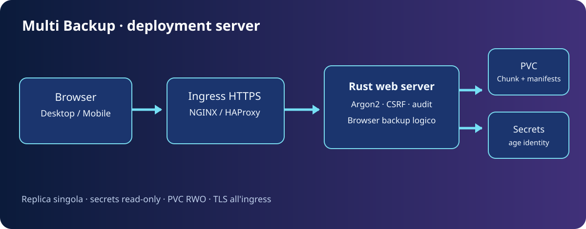
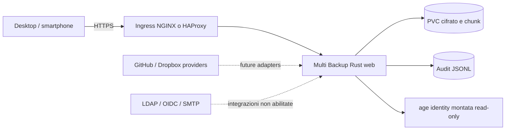

# Multi Backup server — Docker, Podman, Helm e Kubernetes

**Stato: anteprima Rust, non esporre pubblicamente senza revisione di sicurezza.**
La web UI è responsive e condivide palette e concetti del client nativo,
ma la parità pixel/funzionale non è stata ancora completata.

## Struttura





| Funzione | r021 | Richiesto prima di production |
| --- | --- | --- |
| Login locale | Argon2id PHC, cookie HttpOnly, SameSite, sessione 8h | test rate-limit/MFA/lockout e session persistence |
| LDAP/LDAPS | non implementato | TLS+CA, base DN, gruppo, mapping ruoli |
| OIDC SSO | non implementato | issuer, discovery, client, PKCE, nonce, JWKS, ruoli |
| SMTP/SMTPS | non implementato | porta/TLS/STARTTLS, credenziali secret, retry |
| Audit | eventi login/logout/export in JSONL | DB, retention configurabile, filtro, download |
| File browser | elenco file del backup logico autenticato | icone, cartelle gerarchiche, ricerca e mobile QA |
| Export selettivo | nuova directory sul **server**, senza overwrite | ZIP download e client-side export |
| Storage | legge lo store age v1 montato | vault unlock web e provider backup scheduler |
| Mount live | non implementato | FUSE/WinFsp lato host, sandbox e permessi |
| Accessibilità | HTML responsive e tastiera base | WCAG 2.2 AA e test assistive tech |

## Configurazione runtime

| Variabile | Esempio / vincolo |
| --- | --- |
| `MULTI_BACKUP_ADMIN_USER` | `admin` |
| `MULTI_BACKUP_ADMIN_HASH_FILE` | `/run/secrets/admin-hash` (Argon2id PHC) |
| `MULTI_BACKUP_PUBLIC_ORIGIN` | `https://backup.example.org` (esatto, senza slash finale) |
| `MULTI_BACKUP_DATA_ROOT` | `/data/backups` |
| `MULTI_BACKUP_AGE_IDENTITY_FILE` | percorso separato in Secret, read-only |
| `MULTI_BACKUP_EXPORT_ROOT` | `/data/exports` |
| `MULTI_BACKUP_AUDIT_LOG` | `/data/audit/events.jsonl` |
| `MULTI_BACKUP_BIND` | `0.0.0.0:8080` |

La chiave privata non va conservata nei manifest o negli ZIP portabili.
La app non salva password GitHub/Dropbox e non può recuperare GitHub Secrets
(non esportabili in chiaro dalle API).

### Build locale e login

```bash
# Da checkout del repository:
cargo run --manifest-path rust-server/Cargo.toml --bin multi-backup-server -- hash-password
# Salva soltanto l'hash PHC mostrato su stdout in ./secrets/admin_hash
mkdir -p secrets && chmod 700 secrets
# Copia un'identity age già esistente, corrispondente allo storage, in
# ./secrets/age_identity con permessi 0600 (non pubblicarla su Git).

docker build -t desalvo/multi-backup:early-release .
docker compose up -d
# Endpoint locale: http://127.0.0.1:8080
```

Il compose usa un volume permanente `backup_data` e bind locale 127.0.0.1.
Per rete esterna esporre esclusivamente tramite reverse proxy HTTPS verificato,
configurando l'`origin` reale. Podman può usare il medesimo Dockerfile:
`podman build -t multi-backup:preview .` e secrets/volumi compatibili.

### Helm

```bash
kubectl create namespace multi-backup
kubectl -n multi-backup create secret generic multi-backup-auth \
  --from-file=admin-hash=./secrets/admin_hash \
  --from-file=age-identity=./secrets/age_identity

helm upgrade --install multi-backup deploy/helm/multi-backup \
  --namespace multi-backup \
  --set ingress.className=nginx \
  --set ingress.host=backup.example.org \
  --set publicOrigin=https://backup.example.org \
  --set ingress.tlsSecretName=multi-backup-tls
```

Cambiare `className` a `haproxy` se usato il controller HAProxy.
È presente anche l'annotazione legacy
`kubernetes.io/ingress.class` per compatibilità dei controller precedenti.
Configurare un secret TLS valido con cert-manager o modalità equivalente.

### Wizard Kustomize

```bash
cargo run --manifest-path rust-server/Cargo.toml \
  --bin multi-backup-k8s-wizard
kubectl kustomize ./multi-backup-overlay
kubectl apply -k ./multi-backup-overlay
```

Il wizard crea file YAML in una **nuova** directory, chiede namespace,
hostname HTTPS, ingress nginx/haproxy, PVC size e tag immagine; non scrive
segreti e non esegue automaticamente `kubectl apply`. È generata una
referenza locale al percorso assoluto della base: per spostare l'overlay su
un'altra macchina occorre ricalcolare questo riferimento.

### Kubernetes e storage

- Replica **1**: lo store locale e le sessioni in memoria non sono
  implementazioni HA con leader election.
- PVC RWO configurabile; NFS/S3/Ceph necessitano lock, semantica di commit,
  credenziali e test specifici prima dell'uso.
- Pod non privilegiato UID/GID 10001, root FS in sola lettura,
  drop capabilities, `no-new-privileges`, secrets read-only e `/tmp`
  temporaneo. Volumi cifrati raccomandati.
- Liveness/readiness `/healthz` non equivalgono a un test integrità
  dei backup. Aggiungere monitoraggio e restore periodico.
- Il server non effettua mount FUSE: richiedere privilegi di kernel
  direttamente al container sarebbe una superficie di attacco evitabile.

## SMTP(S), LDAP e SSO — contratto di implementazione

| Modalità | Configurazioni da esporre nelle Settings | Verifiche |
| --- | --- | --- |
| Locale | utente, hash Argon2id, MFA, recovery | password policy, rate-limit, audit |
| LDAP/LDAPS | URL, CA bundle, bind secret, Base DN, login attribute, group map | StartTLS cert validation, referral handling |
| OIDC generico | issuer/discovery URL, client ID/secret, callback, scopes, claim mapping | PKCE, state, nonce, JWKS rotation |
| Google/GitHub/Facebook | predisposizione provider e icone originali | OAuth/OIDC provider-specific behavior |
| SMTP | host, 465/587, TLS vs STARTTLS, username/secret, mittente, test | verify certificate, never plaintext creds in log |

Non mostrare un tasto SSO prima che il provider sia configurato e testato.
Le credenziali vanno in Secret Kubernetes o secret manager, mai in configmap.

## CI e Docker Hub

La workflow `.github/workflows/ci.yml` ora definisce un gate di build del
server OCI e un job `publish-container` subordinato a Production Gate
+ validazione Rust/OCI.

| Elemento GitHub | Nome | Valore |
| --- | --- | --- |
| Actions Variable | `DOCKERHUB_USERNAME` | `desalvo` |
| Actions Secret | `DOCKERHUB_TOKEN` | Docker Hub access token con permesso Write |
| Actions Variable opzionale | `ENABLE_STABLE_CONTAINER` | `true` **solo dopo** stable acceptance |

Early: commit su `main` con `[full-ci]`, oppure dispatch manuale.
Stable: versione tag `v*` non RC + abilitazione esplicita dopo i gate.
Image: `docker.io/desalvo/multi-backup`, architetture amd64/arm64,
tag `early-release`, `sha-...`, `stable` e versioni quando consentite.

```text
GitHub PR ──> Production Gate ──> Rust server test ──> OCI build (no push)
main [full-ci] ────────────────> Rust server test ──> Docker Hub early
tag vX.Y.Z + stable enabled ───> Rust server test ──> Docker Hub stable
```

Al momento non risultano certificati il push sul registry, build multiarch
completa, gestione LDAP/SSO/SMTP o sostituzione del frontend nativo.
Non utilizzare le immagini come produzione fino a validazione e pubblicazione.


## Browser gerarchico (revisione r022)

Il frontend web include un albero per cartelle con icone, ricerca dei path, commutatore lista/griglia, selezione multipla con checkbox e `Esporta selezione`. La richiesta HTTPS autenticata invia `selections: [path, ...]` insieme all'ID del **solo backup logico** interessato. Il server usa `restore_many` in un'unica nuova directory, senza overwrite dell'origine. L'export è ancora **server-side**: il download diretto sullo smartphone, il mount live e il restore-in-place devono essere implementati e certificati prima della release.


## Identity and SMTP(S) options — r023 development

External providers are always disabled by default, and require trusted
secrets/certificates and explicit authorization policies. These integrations
are awaiting testing against real directory and identity providers.

| Variable | Example | Safety behavior |
| --- | --- | --- |
| MULTI_BACKUP_LDAP_URL | ldaps://ldap.example.org:636 | LDAPS only, validated TLS |
| MULTI_BACKUP_LDAP_USER_DN_TEMPLATE | uid={user},ou=People,dc=example,dc=org | Escapes username before DN bind |
| MULTI_BACKUP_LDAP_REQUIRED_GROUP_DN | cn=backup,ou=Groups,dc=example,dc=org | Optional required LDAP group |
| MULTI_BACKUP_LDAP_ALLOWED_USERS | alice,bob | Explicit authorization allow-list |
| MULTI_BACKUP_LDAP_GROUP_MEMBER_ATTRIBUTE | member / uniqueMember / memberUid | Controlled group membership check |
| MULTI_BACKUP_OIDC_ISSUER | https://sso.example.org/realms/backup | HTTPS, no HTTP redirect following |
| MULTI_BACKUP_OIDC_CLIENT_ID | multi-backup | Required OIDC audience |
| MULTI_BACKUP_OIDC_SECRET_FILE | /run/secrets/oidc-client-secret | Secret-file only |
| MULTI_BACKUP_OIDC_ALLOWED_SUBJECTS | uuid-1,uuid-2 | Required stable subject allow-list |
| MULTI_BACKUP_SMTP_HOST | mail.example.org | Server TLS verification |
| MULTI_BACKUP_SMTP_TLS | smtps / starttls | No plaintext SMTP |
| MULTI_BACKUP_SMTP_PORT | 465 / 587 | Relay port |
| MULTI_BACKUP_SMTP_FROM / MULTI_BACKUP_SMTP_TO | mailbox addresses | Fixed sender/recipient |
| MULTI_BACKUP_SMTP_USER | account | Optional SMTP account |
| MULTI_BACKUP_SMTP_PASSWORD_FILE | /run/secrets/smtp-password | Password stored in Secret |

OIDC callback URL must exactly match
https://YOUR_PUBLIC_ORIGIN/oidc/callback at your identity provider.
Code+PKCE, state, nonce, cryptographically verified ID token and subject
allow-list are required. Local admin login cannot be impersonated by LDAP.

SMTP test endpoint: POST /api/smtp/test requires a valid session and CSRF
header, sends only to the configured recipient, and returns no secrets.

Helm auth.ldap, auth.oidc and auth.smtp are opt-in. Kubernetes Secret
multi-backup-auth must contain admin-hash, age-identity and, when enabled,
the optional oidc-client-secret and smtp-password keys. For production,
role-based authorization, audit integrity, abuse controls and live provider
interoperability remain explicit acceptance requirements.


### Security hardening (r024 development)

The OIDC state is now bound to the initiating browser using a short-lived Secure, HttpOnly, SameSite=Lax cookie; callbacks with missing/different state are rejected. Local/LDAPS passwords have a bounded 5-failure/15-minute per-account lockout. The SMTP test action is restricted to the local administrator and limited to one invocation per 60 seconds. Audit events now record the authenticated actor rather than attributing every action to the local admin. These controls still require penetration tests, proxy-aware rate limiting, durable shared session storage and operational OIDC/LDAPS/SMTP verification for production.


## Experimental live read-only WebDAV mount

The Rust server has an optional **read-only WebDAV** endpoint at
https://backup.example.org/dav/<64-character-backup-ID>/.

It presents every namespace (Git, CI, metadata, Dropbox) of **one logical
backup** as a single virtual directory tree. The files are streamed in
4 MiB age-authenticated chunks with SHA-256 and HMAC verification; the
server does not create plaintext staging files.

Enable only behind HTTPS with a dedicated 32+ character random token
in the existing multi-backup-auth Kubernetes Secret as key dav-password.
Set Helm auth.dav.enabled=true and auth.dav.user=mount. The server reads
the key from MULTI_BACKUP_DAV_PASSWORD_FILE and authenticates each
PROPFIND/GET/HEAD using HTTP Basic over HTTPS, never the admin password.
PUT/POST/DELETE/MOVE/COPY are denied; PROPFIND limits Depth to 0 or 1.

- macOS: Finder, Go, Connect to Server, paste HTTPS URL
- Windows: Add network location with HTTPS WebDAV/WebClient enabled
- Linux: davfs2 or GUI network volume with TLS validation

This is an **OS-mountable WebDAV volume**, not a native FUSE/WinFsp
filesystem image. Range requests, OS interoperability, long-lived mount
sessions, performance, and credentials must be tested on the relevant
platforms before enabling in production.
