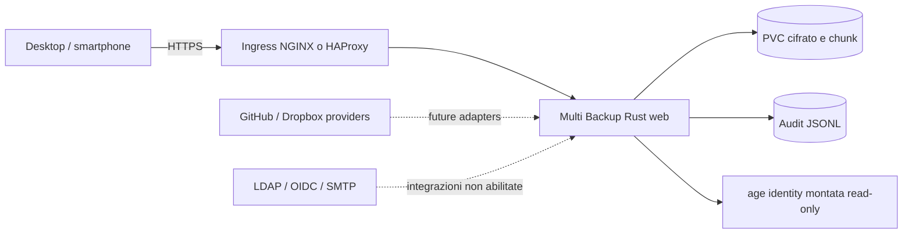

# Multi Backup server — Docker, Podman, Helm e Kubernetes

**Stato: anteprima Rust, non esporre pubblicamente senza revisione di sicurezza.**
La web UI è responsive e condivide palette e concetti del client nativo,
ma la parità pixel/funzionale non è stata ancora completata.

## Struttura




| Funzione | r021 | Richiesto prima di production |
| --- | --- | --- |
| Login locale | Argon2id PHC, cookie HttpOnly, SameSite, sessione 8h | test rate-limit/MFA/lockout e session persistence |
| LDAP/LDAPS | non implementato | TLS+CA, base DN, gruppo, mapping ruoli |
| OIDC SSO | non implementato | issuer, discovery, client, PKCE, nonce, JWKS, ruoli |
| SMTP/SMTPS | non implementato | porta/TLS/STARTTLS, credenziali secret, retry |
| Audit | eventi login/logout/export in JSONL | DB, retention configurabile, filtro, download |
| File browser | elenco file del backup logico autenticato | icone, cartelle gerarchiche, ricerca e mobile QA |
| Export selettivo | nuova directory sul **server**, senza overwrite | ZIP download e client-side export |
| Storage | legge lo store age v1 montato | vault unlock web e provider backup scheduler |
| Mount live | non implementato | FUSE/WinFsp lato host, sandbox e permessi |
| Accessibilità | HTML responsive e tastiera base | WCAG 2.2 AA e test assistive tech |

## Configurazione runtime

| Variabile | Esempio / vincolo |
| --- | --- |
| `MULTI_BACKUP_ADMIN_USER` | `admin` |
| `MULTI_BACKUP_ADMIN_HASH_FILE` | `/run/secrets/admin-hash` (Argon2id PHC) |
| `MULTI_BACKUP_PUBLIC_ORIGIN` | `https://backup.example.org` (esatto, senza slash finale) |
| `MULTI_BACKUP_DATA_ROOT` | `/data/backups` |
| `MULTI_BACKUP_AGE_IDENTITY_FILE` | percorso separato in Secret, read-only |
| `MULTI_BACKUP_EXPORT_ROOT` | `/data/exports` |
| `MULTI_BACKUP_AUDIT_LOG` | `/data/audit/events.jsonl` |
| `MULTI_BACKUP_BIND` | `0.0.0.0:8080` |

La chiave privata non va conservata nei manifest o negli ZIP portabili.
La app non salva password GitHub/Dropbox e non può recuperare GitHub Secrets
(non esportabili in chiaro dalle API).

### Build locale e login

```bash
# Da checkout del repository:
cargo run --manifest-path rust-server/Cargo.toml --bin multi-backup-server -- hash-password
# Salva soltanto l'hash PHC mostrato su stdout in ./secrets/admin_hash
mkdir -p secrets && chmod 700 secrets
# Copia un'identity age già esistente, corrispondente allo storage, in
# ./secrets/age_identity con permessi 0600 (non pubblicarla su Git).

docker build -t desalvo/multi-backup:early-release .
docker compose up -d
# Endpoint locale: http://127.0.0.1:8080
```

Il compose usa un volume permanente `backup_data` e bind locale 127.0.0.1.
Per rete esterna esporre esclusivamente tramite reverse proxy HTTPS verificato,
configurando l'`origin` reale. Podman può usare il medesimo Dockerfile:
`podman build -t multi-backup:preview .` e secrets/volumi compatibili.

### Helm

```bash
kubectl create namespace multi-backup
kubectl -n multi-backup create secret generic multi-backup-auth \
  --from-file=admin-hash=./secrets/admin_hash \
  --from-file=age-identity=./secrets/age_identity

helm upgrade --install multi-backup deploy/helm/multi-backup \
  --namespace multi-backup \
  --set ingress.className=nginx \
  --set ingress.host=backup.example.org \
  --set publicOrigin=https://backup.example.org \
  --set ingress.tlsSecretName=multi-backup-tls
```

Cambiare `className` a `haproxy` se usato il controller HAProxy.
È presente anche l'annotazione legacy
`kubernetes.io/ingress.class` per compatibilità dei controller precedenti.
Configurare un secret TLS valido con cert-manager o modalità equivalente.

### Wizard Kustomize

```bash
cargo run --manifest-path rust-server/Cargo.toml \
  --bin multi-backup-k8s-wizard
kubectl kustomize ./multi-backup-overlay
kubectl apply -k ./multi-backup-overlay
```

Il wizard crea file YAML in una **nuova** directory, chiede namespace,
hostname HTTPS, ingress nginx/haproxy, PVC size e tag immagine; non scrive
segreti e non esegue automaticamente `kubectl apply`. È generata una
referenza locale al percorso assoluto della base: per spostare l'overlay su
un'altra macchina occorre ricalcolare questo riferimento.

### Kubernetes e storage

- Replica **1**: lo store locale e le sessioni in memoria non sono
  implementazioni HA con leader election.
- PVC RWO configurabile; NFS/S3/Ceph necessitano lock, semantica di commit,
  credenziali e test specifici prima dell'uso.
- Pod non privilegiato UID/GID 10001, root FS in sola lettura,
  drop capabilities, `no-new-privileges`, secrets read-only e `/tmp`
  temporaneo. Volumi cifrati raccomandati.
- Liveness/readiness `/healthz` non equivalgono a un test integrità
  dei backup. Aggiungere monitoraggio e restore periodico.
- Il server non effettua mount FUSE: richiedere privilegi di kernel
  direttamente al container sarebbe una superficie di attacco evitabile.

## SMTP(S), LDAP e SSO — contratto di implementazione

| Modalità | Configurazioni da esporre nelle Settings | Verifiche |
| --- | --- | --- |
| Locale | utente, hash Argon2id, MFA, recovery | password policy, rate-limit, audit |
| LDAP/LDAPS | URL, CA bundle, bind secret, Base DN, login attribute, group map | StartTLS cert validation, referral handling |
| OIDC generico | issuer/discovery URL, client ID/secret, callback, scopes, claim mapping | PKCE, state, nonce, JWKS rotation |
| Google/GitHub/Facebook | predisposizione provider e icone originali | OAuth/OIDC provider-specific behavior |
| SMTP | host, 465/587, TLS vs STARTTLS, username/secret, mittente, test | verify certificate, never plaintext creds in log |

Non mostrare un tasto SSO prima che il provider sia configurato e testato.
Le credenziali vanno in Secret Kubernetes o secret manager, mai in configmap.

## CI e Docker Hub

La workflow `.github/workflows/ci.yml` ora definisce un gate di build del
server OCI e un job `publish-container` subordinato a Production Gate
+ validazione Rust/OCI.

| Elemento GitHub | Nome | Valore |
| --- | --- | --- |
| Actions Variable | `DOCKERHUB_USERNAME` | `desalvo` |
| Actions Secret | `DOCKERHUB_TOKEN` | Docker Hub access token con permesso Write |
| Actions Variable opzionale | `ENABLE_STABLE_CONTAINER` | `true` **solo dopo** stable acceptance |

Early: commit su `main` con `[full-ci]`, oppure dispatch manuale.
Stable: versione tag `v*` non RC + abilitazione esplicita dopo i gate.
Image: `docker.io/desalvo/multi-backup`, architetture amd64/arm64,
tag `early-release`, `sha-...`, `stable` e versioni quando consentite.

```text
GitHub PR ──> Production Gate ──> Rust server test ──> OCI build (no push)
main [full-ci] ────────────────> Rust server test ──> Docker Hub early
tag vX.Y.Z + stable enabled ───> Rust server test ──> Docker Hub stable
```

Al momento non risultano certificati il push sul registry, build multiarch
completa, gestione LDAP/SSO/SMTP o sostituzione del frontend nativo.
Non utilizzare le immagini come produzione fino a validazione e pubblicazione.
